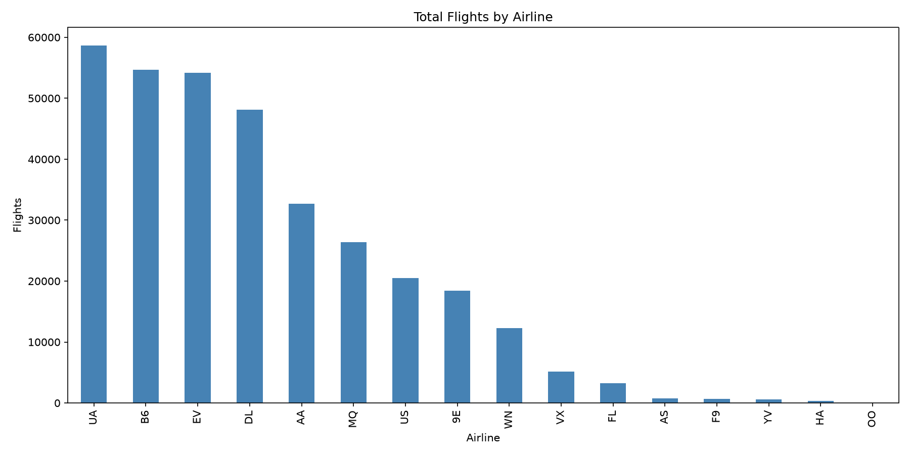
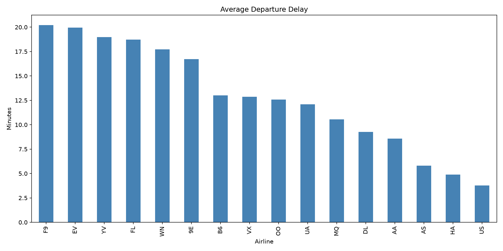
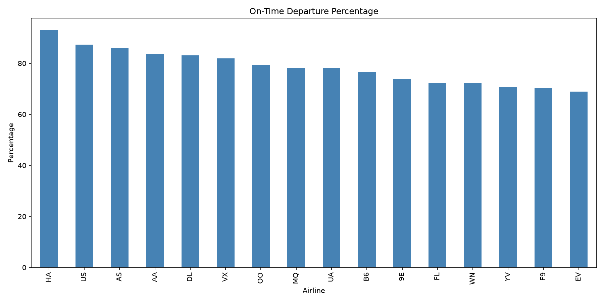
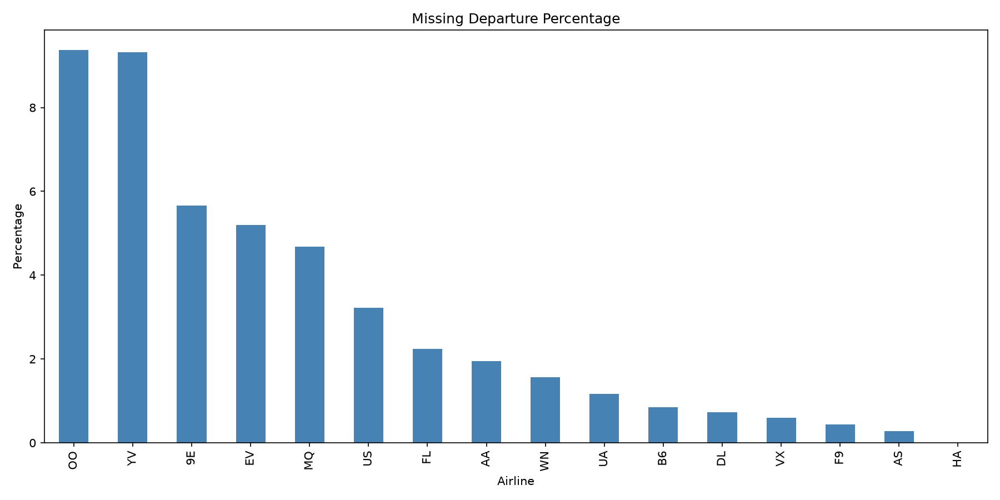

# Flight Data Analysis Using MapReduce

## Overview
This project analyzes airline performance using Python,
MapReduce, Pandas and Matplotlib. It is a smaller portfolio
implementation of my previous academic big data project.

## Dataset
NYC Flights 2013 dataset containing 336,776 flight records.

Source: https://vincentarelbundock.github.io/Rdatasets/csv/nycflights13/flights.csv

## Technologies
- Python
- MapReduce (MRJob)
- Pandas
- Matplotlib
- Apache Oozie (workflow design)
- Pytest
- GitHub Actions

## Analysis
- Flight volume by airline
- Average departure delays
- On-time departure percentages
- Missing departure records

## Results

### Flight Volume

### Departure Delays

### Airline Punctuality

### Missing Departures

[View detailed results](outputs/airline_summary.csv)

## How to Run

Install dependencies:
    pip install -r requirements.txt

Download the dataset into data/flights.csv.

Run MapReduce:
    python src/flight_analysis.py -r local data/flights.csv > outputs/flight_metrics.jsonl

Generate visualizations:
    python src/visualize.py

## Limitations
This portfolio implementation was created in November 2026.
MapReduce runs locally rather than on a distributed Hadoop
cluster. Missing departures are not confirmed cancellations.
On-time departures are defined as delays below 15 minutes.
Oozie is included as a conceptual workflow design only.
